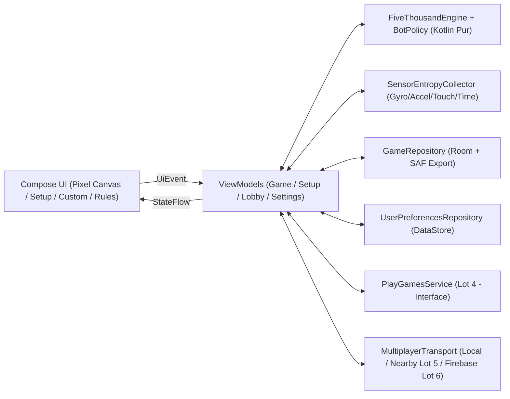

# ARCHITECTURE.md — Architecture & Cartographie du Code

> Ce document décrit les Use Cases de référence, l'architecture cible, le moteur paramétrable du 5000, le collecteur d'entropie, le logging IA, les modes multijoueur et l'emplacement exact des fichiers du projet **Neon 5K**.

---

## 1. Use Cases Nominaux Validés

- **Acteur** : Joueur souhaitant lancer rapidement une partie du jeu de dés 5000 (seul contre des bots, en Pass & Play, en multijoueur local sans Internet ou en ligne), personnaliser librement les règles et le thème cyberpunk/pixel-art, et débloquer des succès Google Play Jeux.
- **Parcours 1 — Création de partie & Règles paramétrables (`SetupScreen`)** :
    1. L'utilisateur choisit un mode : **Solo vs IA**, **Pass & Play (1 appareil)**, **Local sans Internet (Nearby)** ou **En Ligne (Salon privé)**.
    2. Il sélectionne un preset de règles (*Classique 5 dés*, *Variante 6 dés*, *Rapide 2 500*) ou ajuste finement chaque variante optionnelle (`GameRulesConfig`) : nombre de dés, score cible, seuil d'ouverture, score exact, main pleine, carré/quinte, suite, 3 paires, full, repiquage, chapeau/écrasement, pénalité de 3 coups nuls.
    3. Les réglages favoris sont mémorisés dans DataStore.
- **Parcours 2 — Boucle de jeu, Entropie Capteurs & Pixel Art (`GameScreen`)** :
    1. Au tour du joueur, un appui (ou une secousse physique si activée) déclenche le `SensorEntropyCollector` (gyroscope + accéléromètre + `nanoTime` + coordonnées/durée du toucher + sel) qui produit une graine `SHA-256` et tire les dés.
    2. Le joueur sélectionne les dés scorants (aide visuelle néon sur les combinaisons valides + prévisualisation instantanée des points), puis choisit **RELANCER** (avec les dés restants, ou tous les dés en cas de *Main pleine*) ou **BANQUER** (si ouvert ou si le tour atteint le seuil d'ouverture).
    3. Si aucun dé du lancer ne score (*Glitch / Bust*), le cumul du tour est perdu.
    4. Un badge discret affiche le hash court de la graine (`#A4F9C2`) et ouvre une modale « Trace d'Entropie » détaillant les mesures capteurs ayant forgé le lancer.
- **Parcours 3 — Collecte de données IA & Bots Locaux (`domain/ai/` & `data/local/`)** :
    1. Chaque choix de conservation de dés + décision (`ROLL_AGAIN` / `BANK`) est enregistré localement dans Room (`decision_logs`).
    2. À la fin du tour et de la partie, les champs d'issue (`turnFinalPoints`, `matchWon`) sont complétés rétroactivement.
    3. L'utilisateur peut exporter ses datasets en `.jsonl` ou `.csv` via le Storage Access Framework (SAF) pour entraîner des modèles externes (RL / supervisé), ou activer l'envoi anonyme en fin de partie (Lot 6).
- **Parcours 4 — Personnalisation de la fenêtre de jeu (`CustomizationScreen`)** :
    1. L'utilisateur choisit parmi 5 thèmes cyberpunk/pixel prédéfinis ou crée sa propre palette (fond, surface, accent néon principal, accent secondaire, texte) via une roue HSV / code `#RRGGBB` avec contrôle de contraste.
    2. Il règle le style des dés (*Pixel Solid*, *Neon Wireframe*, *Dot Matrix*), l'effet scanlines CRT, l'orientation droitier/gaucher, les vibrations haptiques, la secousse pour lancer et `keepScreenOn`.
- **Parcours 5 — Multijoueur Local Nearby (Lot 5) & En Ligne Firebase (Lot 6)** :
    1. **Nearby (`P2P_STAR`)** : Un téléphone héberge la partie (hôte arbitre), les autres rejoignent par proximité sans Wi-Fi ni compte.
    2. **En Ligne (Firebase RTDB Spark 0 €)** : Un joueur crée un salon et partage un code à 6 caractères ; chaque client calcule son lancer via ses propres capteurs et publie le résultat + preuve d'entropie dans le nœud de la partie.

---

## 2. Vue d'Ensemble (Clean MVVM, UDF & Modules Découplés)



---

## 3. Organisation des Packages (`fr.antoinehory.neon5k`)

```text
fr.antoinehory.neon5k/
├── MainActivity.kt                  # Point d'entrée unique (SplashScreen, Edge-to-Edge, init PGS silencieux Lot 4)
├── domain/                          # KOTLIN PUR (zéro import android.*)
│   ├── rules/
│   │   ├── GameRulesConfig.kt       # Configuration immuable complète + presets (Classique 5d, 6d, Rapide, Custom)
│   │   ├── ScoringCombination.kt    # Modèles de combinaisons scorantes (As, 5, Brelan, Carré, Quinte, Suite, 3 Paires, Full)
│   │   ├── DiceScorer.kt            # Évaluateur exhaustif & validateur de sélection selon GameRulesConfig
│   │   └── FiveThousandEngine.kt    # Machine à états pure (lancer, sélection, banque, main pleine, repiquage, chapeau, 3 nuls)
│   ├── model/
│   │   ├── MatchState.kt            # État immuable complet d'une partie (@Immutable)
│   │   ├── PlayerState.kt           # Joueur (id, nom, type HUMAN/BOT/REMOTE, score, ouvert, série de coups nuls)
│   │   ├── TurnState.kt             # État du tour actif (dés, verrouillés, cumul tour, repiquage disponible)
│   │   ├── EntropySnapshot.kt       # Trace lisible des sources d'entropie + seed SHA-256
│   │   └── DecisionRecord.kt        # Vecteur d'état/action/issue destiné à l'entraînement IA
│   ├── entropy/
│   │   └── EntropySeedGenerator.kt  # Hachage SHA-256 déterministe + tirage uniforme sans biais modulo
│   ├── ai/
│   │   ├── BotPolicy.kt             # Interface stratégie IA (chooseSelection + decideRollOrBank)
│   │   ├── HeuristicBotPolicy.kt    # IA probabiliste V1 (SAFE_RUNNER, CYBER_BALANCED, OVERCLOCK_KAMIKAZE)
│   │   └── RollProbabilityTable.kt  # Probabilités exactes de coup nul selon nb dés et règles actives
│   └── theme/
│       └── CyberPalette.kt          # Modèles de thèmes prédéfinis, palette custom, style de dés & calcul contraste WCAG
├── data/
│   ├── sensors/
│   │   └── SensorEntropyCollector.kt # Lecture non-bloquante gyroscope/accéléromètre + détection secousse + fallback
│   ├── local/
│   │   ├── AppDatabase.kt           # RoomDatabase (neon_5k.db)
│   │   ├── entity/
│   │   │   ├── SavedMatchEntity.kt  # Sauvegarde/reprise de partie & historique
│   │   │   ├── PlayerStatsEntity.kt # Statistiques locales cumulées
│   │   │   └── DecisionLogEntity.kt # Journal structuré des décisions pour dataset IA
│   │   └── dao/
│   │       ├── MatchDao.kt
│   │       ├── StatsDao.kt
│   │       └── DecisionLogDao.kt
│   ├── preferences/
│   │   └── UserPreferencesRepository.kt # DataStore (thème, custom colors, style dés, règles favorites, haptique, opt-in IA)
│   ├── export/
│   │   └── AiDatasetExporter.kt     # Export SAF en JSONL / CSV des logs IA
│   ├── repository/
│   │   └── GameRepository.kt        # Orchestration Room, stats et logs de décisions
│   ├── playgames/                   # LOT 4
│   │   ├── PlayGamesService.kt      # Interface abstraite (NoOp par défaut hors-ligne)
│   │   └── GooglePlayGamesService.kt # Implémentation Play Games Services v2 (succès & profil)
│   └── multiplayer/                 # LOTS 5 & 6
│       ├── MultiplayerTransport.kt  # Interface commune (createRoom, joinRoom, sendAction, observeEvents)
│       ├── NearbyTransport.kt       # Lot 5 : Google Nearby Connections (P2P_STAR)
│       └── FirebaseRtdbTransport.kt # Lot 6 : Firebase Realtime Database (Spark 0 €)
└── ui/
    ├── theme/                       # Neon5KTheme, CyberColors, PixelTypography
    ├── components/                  # PixelDiceCanvas, PixelButton, ScanlineOverlay, EntropyBadgeDialog, ColorPickerDialog
    ├── navigation/                  # NeonNavHost (Home, Setup, Game, Customization, Rules, Stats, Lobby, Info)
    ├── home/                        # Écran d'accueil minimaliste cyberpunk (Reprendre, Nouvelle partie, Règles, Thème, Stats)
    ├── setup/                       # Configuration joueurs, bots et variantes du 5000 (SetupScreen, SetupViewModel)
    ├── game/                        # Plateau principal (GameScreen, GameViewModel, GameUiState)
    ├── customization/               # Studio de personnalisation de la fenêtre de jeu (CustomizationScreen, ViewModel)
    ├── rules/                       # Guide interactif des règles du 5000 et du barème actif (RulesScreen)
    ├── stats/                       # Statistiques, succès locaux & export dataset IA (StatsScreen, ViewModel)
    ├── lobby/                       # Lots 5 & 6 : Salons Nearby / En Ligne (LobbyScreen, LobbyViewModel)
    └── info/                        # Écran À propos, crédits, confidentialité et liens (InfoScreen)
```

---

## 4. Cartographie des Fichiers du Projet

*Mettre à jour ce tableau à chaque création, modification structurante ou suppression de fichier.*

| Chemin relatif | Responsabilité | Statut |
| :--- | :--- | :--- |
| `AGENTS.md` | Point d'entrée IA, index documentaire, catalogue de skills et garde-fous | Actif |
| `docs/ARCHITECTURE.md` | Architecture complète, spécifications moteur 5000, entropie, IA, réseau et cartographie | Actif |
| `docs/CODING_STANDARDS.md` | Standards Kotlin/Compose, Pixel Canvas, Room, capteurs et multijoueur | Actif |
| `docs/ROADMAP.md` | Suivi d'avancement découpé en 6 lots | Actif |
| `docs/DECISIONS.md` | Journal des décisions d'architecture (ADR-001 à ADR-012) | Actif |
| `README.md` | Présentation du projet, règles, stack et commandes Gradle | Actif |
| `CHANGELOG.md` | Historique des livraisons | Actif |
| `PLAY_STORE.md` | Fiche Play Store 4 langues (`fr`, `en`, `es`, `pt`) et specs visuelles | Actif |
| `POLITIQUE_DE_CONFIDENTIALITE.md` | Politique de confidentialité (capteurs, Play Jeux, Nearby, Firebase opt-in) | Actif |
| `app/src/main/res/drawable/ic_launcher_foreground.xml` | Icône adaptative XML pixel-art cyberpunk (dé face 5 néon cyan/magenta) | Actif |
| `app/src/main/res/drawable/ic_launcher_background.xml` | Fond vectoriel XML cyberpunk (`#090A10` avec micro-grille discrète) | Actif |
| `app/src/main/res/values/colors.xml` | Couleurs de base et fond du Splash Screen | Actif |
| `app/src/main/res/values/themes.xml` | Configuration `Theme.Neon5K.Starting` (`core-splashscreen`) | Actif |
| `gradle/libs.versions.toml` | Catalogue des dépendances (Compose BOM, Lifecycle, Splashscreen) | Actif |
| `app/build.gradle.kts` | Configuration `:app` (`fr.antoinehory.neon5k`, `minSdk = 29`, `targetSdk = 37`, R8 global) | Actif |
| `app/src/main/AndroidManifest.xml` | Manifest (`Theme.Neon5K.Starting`, capteurs gyroscope/accéléromètre optionnels) | Actif |
| `app/src/main/java/fr/antoinehory/neon5k/MainActivity.kt` | Activité principale (`installSplashScreen()`, `enableEdgeToEdge()`, `NeonNavHost`) | Actif |
| `app/src/main/java/fr/antoinehory/neon5k/domain/rules/GameRulesConfig.kt` | Configuration immuable des règles et presets du 5000 + `fingerprint()` | Actif |
| `app/src/main/java/fr/antoinehory/neon5k/domain/rules/ScoringCombination.kt` | Modèles `CombinationKind`, `ScoringCombination` et `SelectionEvaluation` | Actif |
| `app/src/main/java/fr/antoinehory/neon5k/domain/rules/DiceScorer.kt` | Évaluateur exhaustif et validateur strict (zéro dé mort) du 5000 | Actif |
| `app/src/main/java/fr/antoinehory/neon5k/domain/rules/FiveThousandEngine.kt` | Machine à états pure Kotlin d'une partie multi-joueurs | Actif |
| `app/src/main/java/fr/antoinehory/neon5k/domain/model/MatchState.kt` | État complet immuable d'une partie (`MatchState`, `EngineResult`, `MoveValidationError`) | Actif |
| `app/src/main/java/fr/antoinehory/neon5k/domain/model/PlayerState.kt` | État d'un joueur (`PlayerState`, `PlayerType`) | Actif |
| `app/src/main/java/fr/antoinehory/neon5k/domain/model/TurnState.kt` | État du tour actif (`TurnState`, `DieState`, `TurnPhase`, `PiggybackOffer`) | Actif |
| `app/src/main/java/fr/antoinehory/neon5k/domain/model/EntropySnapshot.kt` | Échantillon brut (`EntropyRawSample`) et trace lisible (`EntropySnapshot`) | Actif |
| `app/src/main/java/fr/antoinehory/neon5k/domain/model/DecisionRecord.kt` | Modèle pur de décision pour dataset IA | Actif |
| `app/src/main/java/fr/antoinehory/neon5k/domain/entropy/EntropySeedGenerator.kt` | Hachage `SHA-256` déterministe et tirage uniforme `1..6` | Actif |
| `app/src/main/java/fr/antoinehory/neon5k/domain/theme/CyberPalette.kt` | Palettes cyberpunk prédéfinies, styles de dés et calcul de contraste WCAG 2.1 | Actif |
| `app/src/main/java/fr/antoinehory/neon5k/data/sensors/SensorEntropyCollector.kt` | Collecteur non-bloquant gyroscope/accéléromètre/tactile/horloge + détection secousse | Actif |
| `app/src/main/java/fr/antoinehory/neon5k/ui/theme/*` | `Neon5KTheme`, `Neon5KColors`, `LocalNeon5KColors` et typographie Monospace | Actif |
| `app/src/main/java/fr/antoinehory/neon5k/ui/components/PixelDiceCanvas.kt` | Rendu Compose `Canvas` pixel art `16×16` des dés (3 styles, animations, halo néon) | Actif |
| `app/src/main/java/fr/antoinehory/neon5k/ui/components/PixelComponents.kt` | `PixelButton`, `CyberPanel`, `ScanlineOverlay` et `EntropyBadgeDialog` | Actif |
| `app/src/main/java/fr/antoinehory/neon5k/ui/navigation/NeonNavHost.kt` | Hôte de navigation Compose (`HOME`, `SETUP`, `GAME`) | Actif |
| `app/src/main/java/fr/antoinehory/neon5k/ui/home/HomeScreen.kt` | Écran d'accueil minimaliste cyberpunk | Actif |
| `app/src/main/java/fr/antoinehory/neon5k/ui/setup/SetupScreen.kt` | Écran de configuration des joueurs Pass & Play et variantes du 5000 | Actif |
| `app/src/main/java/fr/antoinehory/neon5k/ui/game/GameViewModel.kt` | ViewModel UDF de la table de jeu (moteur + entropie capteurs) | Actif |
| `app/src/main/java/fr/antoinehory/neon5k/ui/game/GameScreen.kt` | Plateau de jeu complet, capture tactile d'entropie et cycle de vie capteurs | Actif |
| `app/src/test/java/fr/antoinehory/neon5k/domain/rules/DiceScorerTest.kt` | Tests unitaires JVM de `DiceScorer` | Actif |
| `app/src/test/java/fr/antoinehory/neon5k/domain/rules/FiveThousandEngineTest.kt` | Tests unitaires JVM de `FiveThousandEngine` | Actif |
| `app/src/test/java/fr/antoinehory/neon5k/domain/entropy/EntropySeedGeneratorTest.kt` | Tests unitaires JVM de `EntropySeedGenerator` | Actif |
| `app/src/main/java/fr/antoinehory/neon5k/domain/ai/RollProbabilityTable.kt` | Calculateur exact et cache des probabilités de coup nul et d'espérance ($6^N$) | Actif |
| `app/src/main/java/fr/antoinehory/neon5k/domain/ai/BotPolicy.kt` | Contrat de stratégie IA et profils `BotProfile` (`SAFE_RUNNER`, `CYBER_BALANCED`, `OVERCLOCK_KAMIKAZE`) | Actif |
| `app/src/main/java/fr/antoinehory/neon5k/domain/ai/HeuristicBotPolicy.kt` | IA probabiliste V1 évaluant les sous-ensembles scorants et l'EV nette | Actif |
| `app/src/main/java/fr/antoinehory/neon5k/data/local/AppDatabase.kt` | Base Room `neon_5k.db` | Actif |
| `app/src/main/java/fr/antoinehory/neon5k/data/local/entity/SavedMatchEntity.kt` | Entité Room de sauvegarde/reprise de partie et mappers JSON | Actif |
| `app/src/main/java/fr/antoinehory/neon5k/data/local/entity/PlayerStatsEntity.kt` | Entité Room des statistiques locales cumulées | Actif |
| `app/src/main/java/fr/antoinehory/neon5k/data/local/entity/DecisionLogEntity.kt` | Entité Room du journal des décisions pour dataset IA | Actif |
| `app/src/main/java/fr/antoinehory/neon5k/data/local/dao/MatchDao.kt` | DAO Room des parties sauvegardées | Actif |
| `app/src/main/java/fr/antoinehory/neon5k/data/local/dao/StatsDao.kt` | DAO Room des statistiques locales | Actif |
| `app/src/main/java/fr/antoinehory/neon5k/data/local/dao/DecisionLogDao.kt` | DAO Room des logs IA (avec `updateTurnOutcome` et `updateMatchOutcome`) | Actif |
| `app/src/main/java/fr/antoinehory/neon5k/data/repository/GameRepository.kt` | Orchestration Room sur `Dispatchers.IO` (reprise, stats, logs IA non-bloquants) | Actif |
| `app/src/main/java/fr/antoinehory/neon5k/data/preferences/UserPreferencesRepository.kt` | Préférences DataStore (thème, palette custom, style dés, règles favorites, ergonomie) | Actif |
| `app/src/main/java/fr/antoinehory/neon5k/data/export/AiDatasetExporter.kt` | Export SAF `.jsonl` / `.csv` des logs IA sans permission de stockage | Actif |
| `app/src/main/java/fr/antoinehory/neon5k/ui/components/ColorPickerDialog.kt` | Sélecteur de couleur hybride HSV / RGB (`0..255`) + bouton Random + `#RRGGBB` avec contrôle contraste WCAG 2.1 | Actif |
| `app/src/main/java/fr/antoinehory/neon5k/ui/components/EasterEggOverlay.kt` | Système d'Easter Eggs multi-taps (Générique Star Wars `42` en dés Pixel Art, Matrix Overclock `1337`, Holocron Aurebesh `7`) | Actif |
| `app/src/main/java/fr/antoinehory/neon5k/ui/customization/CustomizationScreen.kt` | Studio de personnalisation du thème (Cyberpunk, Gris, Sépia, Daltonisme, Random), des dés et de l'ergonomie | Actif |
| `app/src/main/java/fr/antoinehory/neon5k/ui/stats/StatsScreen.kt` | Écran des statistiques locales et de l'export SAF du dataset IA | Actif |
| `app/src/main/java/fr/antoinehory/neon5k/ui/rules/RulesScreen.kt` | Codex des règles du 5000, simulateur interactif de barème Pixel Art et modale `[?]` en partie | Actif |
| `app/src/main/java/fr/antoinehory/neon5k/ui/info/InfoScreen.kt` | Fiche Informations & Crédits (modèle `OCRAurebesh` + 6 réseaux sociaux + PayPal + Play Store `pub:Crock` + sélecteur 4 langues) | Actif |
| `app/src/main/res/drawable/ic_*_logo.xml` | 6 icônes vectorielles XML de réseaux sociaux (`linkedin`, `behance`, `instagram`, `facebook`, `spotify`, `steam`) | Actif |
| `app/src/main/res/xml/locales_config.xml` | Déclaration des 4 langues supportées (`fr`, `en`, `es`, `pt`) pour Android 13+ | Actif |
| `app/src/main/res/values-*/strings.xml` | Ressources traduites en 4 langues (`values`, `values-fr`, `values-en`, `values-es`, `values-pt`) | Actif |
| `app/src/main/java/fr/antoinehory/neon5k/domain/achievement/AchievementDefinition.kt` | Catalogue immuable des 20 succès (1 000 XP, paliers, matrices Pixel Art `16×16`, rangs de maîtrise) | Actif |
| `app/src/main/java/fr/antoinehory/neon5k/domain/achievement/AchievementEvaluator.kt` | Évaluateur pur des 20 succès à comptage infini post-déverrouillage (`lifetimeCount`) | Actif |
| `app/src/main/java/fr/antoinehory/neon5k/data/local/entity/AchievementEntity.kt` | Entité Room d'un succès (`progressSteps`, `lifetimeCount` infini, `masteryRankOrdinal`, `syncedWithPlayGames`) | Actif |
| `app/src/main/java/fr/antoinehory/neon5k/data/local/dao/AchievementDao.kt` | DAO Room des 20 succès | Actif |
| `app/src/main/java/fr/antoinehory/neon5k/data/playgames/PlayGamesService.kt` | Intégration Google Play Jeux v2 (`PlayGamesSdk`, auth silencieuse, `unlock`/`setSteps`, UI native) | Actif |
| `app/src/main/java/fr/antoinehory/neon5k/ui/components/PixelAchievementIconCanvas.kt` | Badge Pixel Art `16×16` des succès + bannière toast néon `AchievementToastBanner` en partie | Actif |
| `app/src/main/res/values/games-ids.xml` | Identifiants Google Play Console (`game_services_project_id` + 20 IDs `achievement_*`) | Actif |
| `docs/PLAY_GAMES_ACHIEVEMENTS.md` | Guide pas-à-pas de déclaration des 20 succès dans Google Play Console + barème 1 000 XP | Actif |
| `docs/play_console_achievements_icons/*.png` | 20 icônes PNG `512 × 512 px` générées automatiquement pour la Google Play Console | Actif |
| `app/src/test/java/fr/antoinehory/neon5k/domain/ai/HeuristicBotPolicyTest.kt` | Tests unitaires JVM de `RollProbabilityTable` et `HeuristicBotPolicy` | Actif |
| `app/src/test/java/fr/antoinehory/neon5k/domain/achievement/AchievementEvaluatorTest.kt` | Tests unitaires JVM de `AchievementEvaluator` et générateur des 20 icônes PNG `512 × 512 px` | Actif |
| `app/src/androidTest/java/fr/antoinehory/neon5k/data/local/NeonDatabaseInstrumentedTest.kt` | Tests instrumentés Room (`MatchDao` & `DecisionLogDao`) | Actif |
| `data/multiplayer/NearbyTransport.kt` | Multijoueur local sans Internet via Nearby Connections (Lot 5) | À créer |
| `data/multiplayer/FirebaseRtdbTransport.kt` | Multijoueur en ligne & sync dataset IA opt-in via Firebase RTDB (Lot 6) | À créer |

---

## 5. Spécifications Techniques Clés

### 5.1. Règles Paramétrables du 5000 (`GameRulesConfig`)
Basé sur les règles de référence Wikipédia (`5 000`), avec préréglages et bascules individuelles :

| Paramètre | Défaut (Classique 5 dés) | Options disponibles |
| :--- | :--- | :--- |
| `diceCount` | `5` | `5` ou `6` |
| `targetScore` | `5 000` | `2 500`, `5 000`, `10 000` |
| `openingThreshold` | `750` | `0`, `500`, `750`, `1 000` |
| `exactFinishRequired` | `true` | `true` (dépassement = tour annulé) / `false` |
| `mandatoryRerollOnHotDice` | `true` | `true` (main pleine = relance obligatoire de tous les dés) / `false` |
| `fourOfAKindMode` | `DOUBLE_TRIPLE` | `DISABLED`, `DOUBLE_TRIPLE` (×2 brelan) |
| `fiveOfAKindMode` | `QUAD_TRIPLE` | `QUAD_TRIPLE` (×4 brelan), `INSTANT_WIN_ON_ONES` |
| `straightScore` | `1 500` | `0` (désactivé), `500`, `1 000`, `1 500` |
| `threePairsScore` (6 dés) | `1 000` | `0` (désactivé), `750`, `1 000`, `1 500` |
| `fullHouseBonus` | `0` (désactivé) | `0` (désactivé), `+200` au brelan |
| `piggybackEnabled` (Repiquage) | `false` | `false` / `true` (reprise des dés restants & du pot du joueur précédent) |
| `bumpOpponentMode` (Chapeau) | `DISABLED` | `DISABLED`, `MINUS_500`, `RESET_TO_PREVIOUS` (recul au palier précédent dans la pile `checkpoints`) |
| `threeStrikesMode` (3 Encoches `✕`) | `DISABLED` | `DISABLED`, `MINUS_500`, `MINUS_1000`, `REVERT_TO_PREVIOUS_CLEAR_STRIKES`, `REVERT_TO_PREVIOUS_PERSIST_STRIKES` (recul au palier précédent en conservant ses encoches historiques `✕`) |

**Règles immuables du validateur (`DiceScorer`) :**
- Le joueur ne peut verrouiller que des dés qui participent activement au score du lancer courant (aucun dé « mort » autorisé dans la sélection).
- Au moins 1 dé ou combinaison scorante doit être mis de côté après chaque lancer avant de pouvoir relancer ou banquer.
- Les combinaisons (brelan, carré, quinte, suite, 3 paires, full) doivent être obtenues **en un seul lancer** (les dés verrouillés lors d'un lancer précédent ne fusionnent pas avec le nouveau lancer pour former un brelan).

### 5.2. Collecteur d'Entropie Hybride (`SensorEntropyCollector` + `EntropySeedGenerator`)
1. À chaque lancer, un `EntropyRawSample` agrège :
   - `gyroX, gyroY, gyroZ` (`Float?`, `null` si capteur absent)
   - `accelX, accelY, accelZ` (`Float?`, `null` si capteur absent)
   - `epochMillis: Long` (`System.currentTimeMillis()`)
   - `nanoTime: Long` (`System.nanoTime()`)
   - `uptimeNanos: Long` (`SystemClock.elapsedRealtimeNanos()`)
   - `touchX, touchY: Float` & `pressDurationMs: Long`
   - `rollCounter: Int` + `batteryLevel: Int?` + `secureSaltHex: String` (4 octets via `SecureRandom`)
2. `EntropySeedGenerator` sérialise cet échantillon en chaîne canonique UTF-8, calcule son empreinte `SHA-256`, extrait les 8 premiers octets en `seed: Long`, puis initialise `kotlin.random.Random(seed)` pour tirer les `N` dés dans `1..6`.
3. L'objet `EntropySnapshot` (hash court sur 8 caractères hex + résumé des sources actives) est attaché au `TurnState` pour l'affichage ludique dans l'UI et la traçabilité en multijoueur.

### 5.3. Schéma du Dataset IA (`DecisionLogEntity` dans Room)
Chaque décision humaine ou bot insère une ligne compacte :
- `id: Long` (auto-incrément)
- `matchUuid: String` (UUID anonyme de la partie)
- `rulesFingerprint: String` (hash des règles actives pour ne pas mélanger des variantes incompatibles à l'entraînement)
- `turnIndex: Int`, `stepIndex: Int`
- `actorType: String` (`"HUMAN"`, `"BOT_SAFE"`, `"BOT_BALANCED"`, `"BOT_KAMIKAZE"`)
- `myScore: Int`, `bestOpponentScore: Int`, `turnScoreBefore: Int`, `remainingDiceBefore: Int`
- `isOpened: Boolean`, `consecutiveBusts: Int`
- `rolledDiceCsv: String` (trié, ex. `"1,1,3,5,6"`)
- `keptDiceCsv: String` (trié, ex. `"1,1"`)
- `decision: String` (`"ROLL_AGAIN"` ou `"BANK"`)
- `turnFinalPoints: Int?` (complété à la fin du tour : `0` si coup nul, sinon points banqués)
- `matchWon: Boolean?` (complété à la fin de la partie)
- `uploadedToCloud: Boolean` (utilisé au Lot 6 pour éviter tout doublon)

### 5.4. Direction Artistique Cyberpunk / Pixel Art, Accessibilité & Easter Eggs
- **Grille pixel entière & 3 Styles de Dés distincts (`PixelDiceCanvas`)** :
  - `PIXEL_SOLID` (*Plein 3D*) : Bloc rétro plein avec remplissage coloré saturé, biseau 3D arcade clair (haut/gauche) et sombre (bas/droite), et points contrastés.
  - `NEON_WIREFRAME` (*Filaire Néon*) : Hologramme transparent creux à double cadre CAO interne, encoches de mire centrales et points vectoriels détourés.
  - `DOT_MATRIX` (*Matrice LED*) : Afficheur à diodes LED circulaires (`drawCircle`) avec matrice de diodes éteintes en fond et diodes lumineuses pour le contour et les points.
- **Icônes Pixel Art `8×8` & En-têtes Harmonisés (`PixelComponents.kt`)** :
  - `PixelIconCanvas` : 15 icônes Pixel Art `8×8` (`PLAY`, `GAMEPAD`, `BOLT`, `PALETTE`, `TROPHY`, `BOOK`, `INFO`, `DICE`, `SPARKLE`, `CHAOS`, `BACK`, `HEART`, `STAR`, `GRID`, `EXPORT`) intégrées aux `PixelButton`.
  - `NeonSubScreenTopBar` : Barre supérieure unifiée sur 1 seule ligne (`titleMedium`, `maxLines = 1`, `spacedBy(12.dp)`) sur toutes les sous-activités.
- **Palettes prédéfinies (`CyberThemePreset`) classées en 4 familles** :
  - **Cyberpunk & Rétro** : `NEON_NIGHT` (défaut), `TERMINAL_PHOSPHOR`, `CRT_AMBER`, `POCKET_MONO`, `OLED_MINIMAL`.
  - **Niveaux de Gris (3 contrastes)** : `GRAYSCALE_SOFT` (bas contraste), `GRAYSCALE_BALANCED` (moyen), `GRAYSCALE_HIGH` (noir & blanc pur 21:1).
  - **Sépia (3 contrastes)** : `SEPIA_SOFT` (parchemin), `SEPIA_CLASSIC` (rétro), `SEPIA_HIGH` (intense).
  - **Accessibilité Daltonisme** : `DALTONISM_PROTA_DEUTERA` (palette Okabe-Ito Bleu `#56B4E9` / Orange `#E69F00` / Jaune `#F0E442` sans ambiguïté rouge-vert), `DALTONISM_TRITANOPIA` (Cyan `#00E5CC` / Corail `#FF3B6B`), `DALTONISM_ACHROMATOPSIA` (monochromatie haute luminance).
- **Générateurs Aléatoires & Mode `CUSTOM`** :
  - **Random Harmonieux** (`CyberPalette.randomHarmonious()`) : génère une palette cohérente par accords triadiques/complémentaires avec contraste WCAG AA/AAA garanti.
  - **Random Chaos** (`CyberPalette.randomChaos()`) : génère une palette 100 % aléatoire débridée.
  - **Color Picker Hybride (`ColorPickerDialog`)** : bascule entre **Mode HSV** et **Mode RGB (`0..255`)**, saisie directe `#RRGGBB`, bouton **Random** intégré et calcul en direct du ratio WCAG 2.1.
- **Système d'Easter Eggs Multi-Taps (`EasterEggOverlay.kt`)** :
  - **Secret #1 (`42` taps sur la bannière des dés de `HomeScreen`)** : Ouvre `StarWars42EasterEggDialog` en plein écran spatial étoilé avec un grand **`42` jaune (`#FFE81F`) composé de vrais dés Pixel Art du jeu (`PixelDiceCanvas`)**, suivi de la citation en anglais original quelle que soit la langue active : *"Answer to the Ultimate Question of Life, the Universe, and Everything"*, qui s'éloigne en perspective inclinée (`rotationX = 56f`) comme le générique de *Star Wars*.
  - **Secret #2 (`13` taps sur le panneau d'entropie hybride de `HomeScreen`)** : Ouvre `Matrix1337EasterEggDialog` (*"OVERCLOCK 1337 // Wake up, Runner... Follow the White Dice"* en dés LED Phosphor).
  - **Secret #3 (`7` taps sur le badge de version en bas de `InfoScreen`)** : Ouvre `HoloAurebeshEasterEggDialog` (clin d'œil galactique à `OCRAurebesh` et au Sabacc : *"Never tell me the odds! 1 / 7 776"*).

### 5.5. Système de 20 Succès à Comptage Infini & Télémétrie Fun (Lot 4)
- **Comptage continu post-déverrouillage** : Chaque succès (`AchievementId`) est stocké dans Room (`AchievementEntity`) avec :
  - `isUnlocked: Boolean` + `unlockedAtEpochMs: Long?` (déclenché dès que `lifetimeCount >= targetSteps`, et synchronisé vers Google Play Jeux via `AchievementsClient.unlock(pgsId)` ou `setSteps(pgsId, count)`),
  - `lifetimeCount: Int` qui **ne s'arrête jamais au palier** (`1/1 → Total à vie : ×14`) et attribue un rang de maîtrise local (*Bronze*, *Argent*, *Or*, *Cyber-Platine*).
- **Télémétrie Fun (`PlayerStatsEntity` enrichi)** :
  - **Vérificateur d'équité SHA-256** : Histogramme exact du nombre d'apparitions de chaque face (`face1Count` à `face6Count`) sur l'ensemble des dés lancés.
  - **Détail des Brelans & Combinaisons** : Compteur total des brelans + répartition exacte par face (`triple1Count` à `triple6Count`), nombre de Carrés, Quintes, Suites, 3 Paires et Fulls.
  - **Psychologie & Risque** : Total des points banqués vs total des points perdus en Glitch (ratio d'avidité), pire pot perdu sur un seul coup nul (`worstBustPotLost`), nombre de lancers déclenchés par secousse physique (`shakeRollsCount`), sauvetages à 1 seul dé (`oneDieClutchCount`), chapeaux infligés vs subis.
- **Assets Visuels des Succès & Déclaration Google Play Console** :
  - Dans l'app : Badges Pixel Art `16×16` dédiés pour chacun des 20 succès (rendus via `Canvas` / `VectorDrawable` avec les couleurs néon du thème actif quand débloqué, et en wireframe atténué quand verrouillé).
  - Pour la Google Play Console (*Services de jeux Play > Configurer > Succès*) : Chaque succès sur le Play Store requiert un **Nom** (max 100 car.), une **Description** (max 500 car.), un type (**Standard** ou **Incrémentiel** à $N$ étapes), une valeur en **XP** (total max 1 000 XP répartis sur les 20 succès, soit 25 à 100 XP par succès) et une **icône `512 × 512 px` PNG/JPG** (Google génère automatiquement la version grisée verrouillée). Un utilitaire/script permettra de générer les 20 PNG `512 × 512 px` à partir des matrices Pixel Art de l'application, accompagnés de la fiche récapitulative `res/values/games-ids.xml`.

### 5.6. Contrats Multijoueur (Lot 5 Nearby & Lot 6 Firebase)
- **Interface commune `MultiplayerTransport`** : Le `GameViewModel` ne connaît pas l'implémentation sous-jacente ; il consomme un `Flow<NetworkGameEvent>` et envoie des `NetworkGameCommand` (sérialisés en JSON compact `kotlinx.serialization`).
- **Lot 5 (Nearby Connections)** : Topologie `Strategy.P2P_STAR`. L'hôte fait tourner `FiveThousandEngine` comme source de vérité et diffuse l'état minimal (`MatchSnapshot`) après chaque action.
- **Lot 6 (Firebase RTDB Spark 0 €)** :
  - Nœud `/rooms/{roomCode}` (code alphanumérique à 6 caractères, TTL logique 24h) contenant `rules`, `players`, `activeTurnIndex`, `lastAction` (avec `entropyHash` et `rolledDice`).
  - Présence via `.info/connected` + `onDisconnect()`.
  - Nœud `/ai_datasets/{rulesFingerprint}/{matchUuid}` : **1 seule écriture JSON compressée par partie terminée**, uniquement si `shareAnonymousAiLogs == true`.
